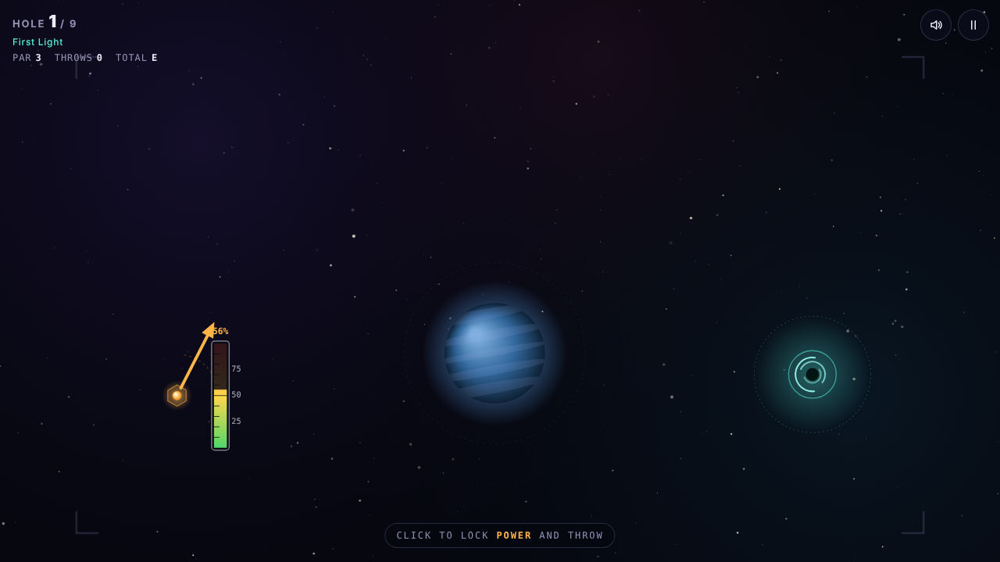

# Orbit Toss

A 9-hole space-golf browser game. Instead of hitting the ball, you throw it, and gravity from planets, moons and black holes bends its path towards a wormhole "cup".

**▶ Play it here: https://sean-g06.github.io/orbit-toss/**

## How to play

1. An arrow sweeps left and right. **Click** (or tap, or press Space) to lock the **direction**.
2. A power bar fills and empties. **Click again** to lock the **power** and throw.
3. Gravity curves the ball. Land it in the glowing wormhole. Arrive too fast and it skims straight over.

Right-click or Esc lets you re-aim before throwing. P pauses. It works on desktop and mobile.

Each hole introduces something new: planets, orbiting moons, asteroids, black holes, repulsor stars that push the ball away, wormhole pairs that teleport it, and nebulae that slow it down. A scorecard at the end shows your score against par.

## How the physics works

- **Inverse-square gravity.** Every physics step, each planet, moon and black hole pulls the ball with a force proportional to its mass ÷ distance². The pulls from all objects are added together. Repulsor stars use the same formula with the sign reversed.
- **Short-range force clamping.** As distance → 0, inverse-square force → infinity, which would fling the ball off the screen. The distance used in the calculation is therefore never allowed to be smaller than the object's radius.
- **Fixed timestep with substeps.** Physics runs in fixed steps of **1/240 s**, independent of the screen's frame rate. An accumulator runs as many steps as needed each frame (about 4 per frame on a 60 Hz screen, 8 at 30 fps), so the same throw follows the same path on every device.
- **Cup gravity wells.** Each cup has a gentle pull plus a drag zone (the dotted ring) that slows the ball, so near misses can still drop in.
- **Collisions.** The ball bounces off solid bodies with some energy lost, rolls with friction, and can come to rest on a planet. The next throw starts from where it stopped.

## Testing and tuning

I made solvability a requirement in the specification: every hole had to be completable with a well-timed throw. An automated tester ran thousands of direction/power combinations through the game's own physics. The results showed the first version gave players only about a 40 ms click window, which is far too tight for humans. So the arrow sweep was slowed and gravity wells were added around the cups, widening the window to about 140 ms on hole 1. Hole 6 came out about four times harder than the others, so its par was raised from 3 to 4.

## Built with

- HTML5 Canvas and vanilla JavaScript: a single self-contained file with no libraries or external assets
- Web Audio API for generated sound effects
- **AI-assisted development:** I designed the game and wrote the specification, then built it with Claude as an AI coding partner, iterating on the gameplay and difficulty.

## Run locally

Download `index.html` and open it in any modern browser.
